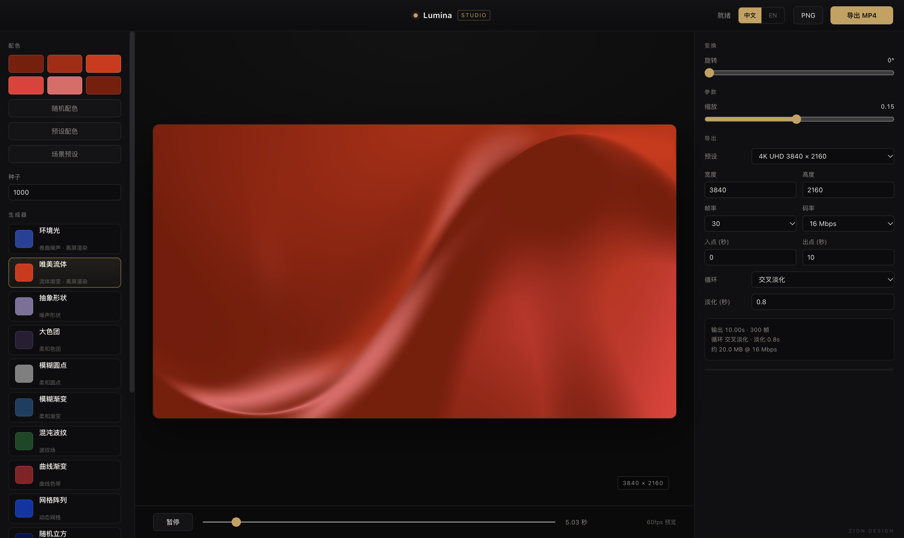

# Lumina Studio

A local studio for ambient, generative backgrounds. Pick a generator, tune color and motion,
transform the frame, and export a seamless H.264 MP4 at your own resolution, frame rate, and duration.

Built with Electron + Chromium WebGL + WebCodecs. macOS 26 / Apple Silicon package.
The core is platform-neutral; a portable Windows build is included (x64, no installer).

界面默认中文，右上角 **中文 / EN** 切换，语言偏好保存在本地；切换语言不改变任何控件的位置。



## Credits and upstream

Lumina Studio is a desktop studio built **on top of the open-source
[color4bg.js](https://github.com/winterx/color4bg.js) project by
[winterx](https://github.com/winterx)** (MIT licensed), which is also the engine
behind [color4bg.com](https://www.color4bg.com).

- The 14 generators (`AmbientLightBg`, `AestheticFluidBg`, `AbstractShapeBg`, …) come from the
  `color4bg` npm package (v0.1.1) and are used unchanged.
- The 245 palette presets and the four presentation scenes are the colors shown on color4bg.com.
- Everything else — the Electron shell, the transform controls, the deterministic preview, and the
  WebCodecs MP4 export pipeline — is original to this project.

If you only want the background generators in a web page, use the upstream library directly.
This repository exists because the upstream library has no offline desktop app with MP4 export.

## Features

- 14 generators: Ambient Light, Aesthetic Fluid, Abstract Shape, Big Blob, Blur Dot,
  Blur Gradient, Chaos Waves, Curve Gradient, Grid Array, Random Cubes, Step Gradient,
  Swirling Curves, Triangles Mosaic, Wavy Waves
- **245 palette presets copied from color4bg.com** (9 categories, exact site colors)
- Palette **favorites** and **recently used** (persisted locally)
- **Four presentation scene presets** from color4bg.com: black-red, blue ambient, black blur, red blur
- 6-color palette picker, seed, per-generator sliders
- **Transform for every generator**: rotation 0–360°
- 60 fps deterministic preview, play/pause, scrub
- Export MP4 H.264 High, yuv420p, no audio:
  - **default 4K 3840×2160**, 21:9 ultrawide 3440×1440, 32:9 super ultrawide 3840×1080
  - width/height 64–3840 × 64–2160, 3840×2160 pixel budget
  - FPS 24 / 25 / 30 / 50 / 60
  - duration 1–60 s, in/out points
  - loop: crossfade 0.2–1.0 s, ping-pong, hard cut
  - bitrate 8 / 12 / 16 / 24 / 40 Mbps
- Export current frame as PNG
- Native save dialog
- Chinese / English UI with fixed, locale-independent layout

JS snippet and WebM export are intentionally not included.

## Run the app

Unzip `Lumina-Studio-1.7.0-mac-arm64.zip`, right-click **Lumina Studio.app** → **Open**.
If macOS quarantines it:

```bash
xattr -dr com.apple.quarantine "/path/to/Lumina Studio.app"
```

## Verified on this Mac (macOS 26, Apple Silicon)

| Test | Result |
|---|---|
| 3840×708, 30 fps, 10 s, crossfade | ~5.6 s export, 9.1 MB |
| 3840×708, 60 fps, 10 s, crossfade | ~7.3 s export, 6.0 MB |
| 1920×1080, 60 fps, 2 s, ping-pong | 3.98 s output, 60 fps |
| 30° rotation, 1920×1080 | exports filled frame, no black corners |
| 14 generators | all render in preview |
| Chinese ↔ English | 20 key elements, 0 position mismatch |
| Palette presets | 245 palettes from 9 site categories; 5-color palettes cycle the first color to fill 6 |
| Scene presets | four color4bg presentation scenes apply generator + colors + params + seed |
| Preview = export | all 13 generators match the preview within 1.5 mean-abs-diff at 4K |
| Cold start | ~0.5 s warm; the app was previously unsigned with a broken bundle signature, which forced macOS to deep-verify 274 MB on every launch |
| Windows package | portable exe, 16-file asar, four locales |
| App icon | ribbon design, `.icns` (macOS) and 7-size `.ico` (Windows), verified embedded |

OpenH264 software encoding is used on this machine (Electron/Chromium); no ffmpeg dependency.

## Known gaps

- App is unsigned and not notarized; internal use only.
- The Windows portable exe is built and structurally verified on macOS, but not yet executed on Windows hardware. Test MP4 export there.
- Some generator defaults/parameters are still being tuned to the site.
- The bundle is ad-hoc signed (`identity: "-"`) and only ships runtime files; unneeded locales are trimmed by `electronLanguages`.
- Exports render each frame in preview space and then scale the scene to the output resolution, so the exported video reproduces the preview composition instead of re-deriving it at a larger pixel size.

## Dev

```bash
pnpm install
pnpm start            # builds renderer, launches Electron
pnpm run build:renderer
```

Build the macOS app (unsigned):

```bash
node node_modules/electron-builder/out/cli/cli.js --mac dir --arm64
```

The project points `electronDist` at `node_modules/electron/dist` so it does not
download Electron again. On a clean machine, run `node node_modules/electron/install.js`
or unpack the Electron zip into that folder first.

## Windows portable

`Lumina Studio 1.7.0.exe` is a portable self-extracting build: double-click to run,
no installer, no admin rights, settings live in `%APPDATA%`. Windows 10/11 x64.
It is unsigned, so SmartScreen may ask for confirmation ("More info" → "Run anyway").

The Windows package ships only runtime files (16 files, 1.7 MB asar) and four UI
locales, matching the macOS payload.

### Encoding note

MP4 export uses the system H.264 encoder through WebCodecs. The codec picker
tries H.264 Level 5.1 down to Level 3.1 and both High and Main profiles, so
machines with a limited Media Foundation encoder still export. If a machine has
no H.264 encoder at all, export reports it explicitly instead of failing silently.

## Architecture (Windows-portable)

- `electron/main.js` — window, save dialogs, IPC; no macOS-only APIs in the core path.
- `electron/preload.js` — context bridge.
- `src/renderer/app.js` — UI, generator registry, deterministic renderer, transform, export pipeline.
- `src/renderer/i18n.js` — Chinese / English strings.
- `dist/renderer.js` — esbuild bundle.
- Encoder: WebCodecs `VideoEncoder` (H.264) + `mp4-muxer`. On Windows the same code path
  should use Media Foundation or OpenH264; an ffmpeg fallback can be added behind the encoder seam.
- No native Node modules; paths use Node `path`; build targets are per-platform.
